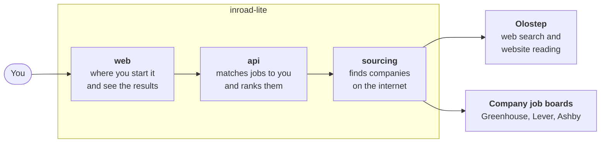
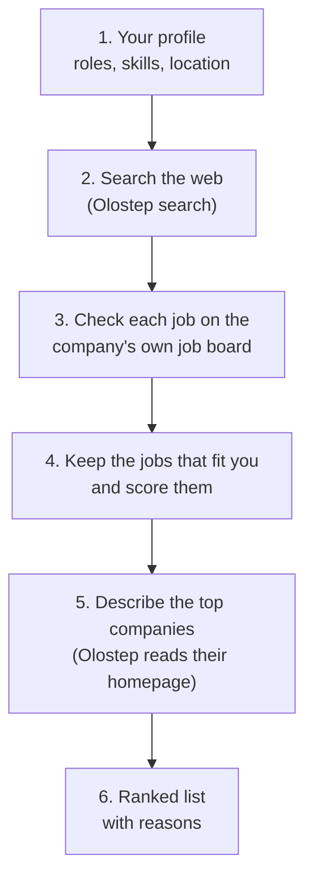
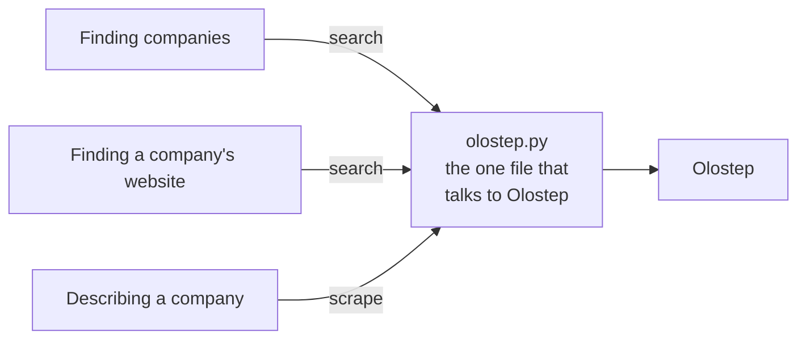

# inroad-lite

[](https://github.com/alishair7071/inroad-lite/actions/workflows/ci.yml)

**Tell it the jobs you want. It finds companies hiring for them right now,
checks every opening is real, and ranks them by how well they fit you, with
the reason for each one.** It uses [Olostep](https://olostep.com) to search
the web and read company websites.

## What this project is

[Inroad](https://inroad-web.vercel.app/) is a platform that helps people find
companies worth applying to, research them, and reach out.

**This is not the full Inroad.** It is a smaller, open-source version that
keeps only the core: finding companies and matching them to a person.

- The full Inroad is several separate apps (a website, a backend, a data
  service), each in its own repository, with databases and background jobs.
- inroad-lite is **one repository**. Each of those apps becomes a **folder**
  with the same name and the same job, so the design is the same, just
  smaller. It runs from the command line, with no database.

## How it works

You describe yourself in a short file: the roles you want, your skills, where
you live, and whether you want remote work or to relocate. inroad-lite then:

1. **Searches the web with Olostep** for open jobs matching your roles.
2. **Checks each job on the company's own job board**, so only real, still-open
   jobs are kept.
3. **Matches the jobs to you**: is it your kind of role, your level, and can
   you work it from where you live?
4. **Scores and ranks** the companies, and explains every score.
5. **Describes the top companies** by reading their homepage with Olostep.

### The parts



- **web** is the front door. In the full Inroad it is the website; here it is
  a command you type.
- **api** knows about you. It decides which jobs suit you and ranks them.
- **sourcing** knows about the outside world. It finds companies and checks
  their jobs. It never sees your full profile, only the roles, skills and
  place it needs to search.

### What happens when you run a search



1. **Your profile.** For example: Backend Engineer, Python and Docker, living
   in Lahore, open to remote work.
2. **Search.** sourcing turns that into a few web searches and runs them
   through Olostep at the same time. It searches only company job boards, so
   every result points to a real employer.
3. **Check.** A search result can be out of date, so sourcing opens each
   company's job board and keeps the company only if the job is still open.
4. **Fit and score.** api checks each job against you. A remote job open only
   in the US does not fit someone in Pakistan; a senior job does not fit
   someone with one year of experience. Jobs that fit get a score out of 100.
5. **Describe.** For the best few companies, sourcing finds their website and
   Olostep reads the homepage, giving a one-line description.
6. **Result.** You get the companies, best first. Every score shows why, and
   every company left out is counted with the reason.

A shortened real result, from a `--relaxed` run (with all checks on, the
strict rules kept 1 company for this profile, because most remote jobs are
open only in the US or Europe):

```text
40 results -> 25 job boards read -> 20 companies that fit you, best 10 shown (relaxed)

 1. YipitData   83 (strong)
    yipitdata.com  YipitData tracks trillions in live consumer and business spend ...
    Backend Engineer   97
      Role     Matches your target Backend Engineer
      Skills   Names Python, Docker, AWS, Kubernetes
      Level    Mid level, fits your 2 years
      Posted   23 days ago
```

Full examples are in [`examples/`](examples/).

## Where Olostep is used

Every call to Olostep goes through **one file**, so it is easy to see exactly
how Olostep is used. There are three kinds of call:



| What it does | File to open |
|---|---|
| The only code that calls Olostep: search and scrape, with a time limit, a retry, and a running count of credits | [`sourcing/net/olostep.py`](src/inroad_lite/sourcing/net/olostep.py) |
| Writes the job searches sent to Olostep | [`sourcing/discovery/company_candidates.py`](src/inroad_lite/sourcing/discovery/company_candidates.py) |
| Runs those searches, several at once, to find companies | [`sourcing/services/company_discovery.py`](src/inroad_lite/sourcing/services/company_discovery.py) |
| Finds a company's website with a search, then reads its homepage with a scrape | [`sourcing/services/company_profile.py`](src/inroad_lite/sourcing/services/company_profile.py) |
| Sets Olostep up with your key, the time limit, and a cache so repeat runs cost nothing | [`sourcing/api/dependencies.py`](src/inroad_lite/sourcing/api/dependencies.py) |

A full search costs about 20 to 40 Olostep credits (5 per search, 1 per page
read). Answers are saved for 6 hours, so running it again costs nothing.

## Try it

You need [uv](https://docs.astral.sh/uv/) and an Olostep API key.

```bash
git clone https://github.com/alishair7071/inroad-lite.git
cd inroad-lite
uv sync
cp .env.example .env                  # put your OLOSTEP_API_KEY in .env
uv run inroad-lite check              # confirms the key works
uv run inroad-lite search profile.example.yaml
```

Copy [`profile.example.yaml`](profile.example.yaml) to describe yourself.
Add `--relaxed` to skip the location and level checks.

For engineers: a detailed technical write-up is in
[docs/architecture.md](docs/architecture.md), and `uv run pytest` runs the
tests without a key.

## How to test it

After the steps in **Try it**, run these one by one. Each says what you
should see.

1. **Check your Olostep key works.**
   ```bash
   uv run inroad-lite check
   ```
   You should see something like `Olostep key works: 12 results, 5 credits used.`

2. **Run a search with the example profile.**
   ```bash
   uv run inroad-lite search profile.example.yaml
   ```
   Takes under a minute the first time. You get a ranked list of companies,
   each with a score and the reasons, then a "Left out" list saying why the
   other companies were dropped, and the Olostep credits the run used.

3. **Run it with the checks relaxed.**
   ```bash
   uv run inroad-lite search profile.example.yaml --relaxed
   ```
   You should see more companies. Each one marked "location not checked" is
   a job you might not be able to work from your country.

4. **Run the same search again.**
   ```bash
   uv run inroad-lite search profile.example.yaml
   ```
   Same result, much faster, and the last line says `0 credits`: Olostep's
   answers were saved and reused.

5. **Search for yourself.** Copy `profile.example.yaml` to `profile.yaml`,
   change the roles, skills and location, and run:
   ```bash
   uv run inroad-lite search profile.yaml
   ```

6. **Save the result to a file**, to look at or share:
   ```bash
   uv run inroad-lite search profile.yaml --json results/me.json
   ```

7. **Run the automated tests.** No key and no internet needed: they use a
   pretend Olostep and pretend job boards.
   ```bash
   uv run pytest
   ```
   Every test should pass in a few seconds.
