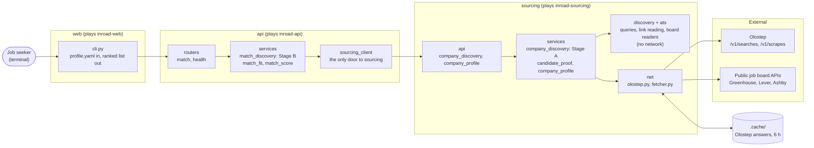
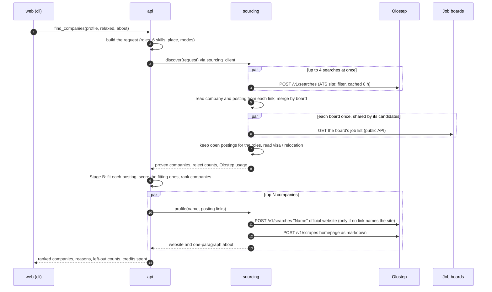
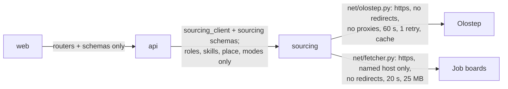

# inroad-lite architecture

How inroad-lite is put together: the three parts, what each one owns, how a
search moves through them, and where it differs from
[Inroad](https://inroad-web.vercel.app/). It follows the layout of Inroad's
own `system-architecture.md`, scaled down to the one flow it keeps: find
companies hiring for a profile.

## 1. The parts

In Inroad these are separate services in separate repos, talking over HTTP.
Here each is a package under `src/inroad_lite/`, with the same name, the same
layers and the same rules about who may call whom.

| Part | Mirrors | What it is | Owns |
|---|---|---|---|
| `web` | `inroad-web` | The command line | Reading the profile file and printing results. Talks to `api`, nothing else |
| `api` | `inroad-api` | Routers, services, schemas | The person: their profile, whether a posting fits them (Stage B), the score and its reasons |
| `sourcing` | `inroad-sourcing` | Entry points, services, board readers, network layer | Everything that reads the outside world: Olostep search and scrape, public job boards. Holds no user data |
| `core` | each repo's `core/` | Settings, cache, country table | Shared helpers, no feature logic |

Two rules hold the split together, as in Inroad:

- **Sourcing never sees the person.** It receives roles, at most six skill
  terms, a city and country, and work modes. Never years of experience, the
  full profile, or anything else about who is asking.
- **Only one door between parts.** `web` calls `api`'s routers;
  `api` reaches sourcing only through `api/services/sourcing_client.py` and
  sourcing's published schemas; only `sourcing/net/` opens a connection.

`tests/test_architecture.py` reads every module's imports and fails the
build if any of these rules is broken.

## 2. Architecture diagram



## 3. Who owns what

| Thing | Owner | Why there |
|---|---|---|
| The profile (roles, skills, place, years, preferences) | `api` | It is about a person |
| The search request | built by `api`, read by `sourcing` | `api` decides what little crosses |
| Search queries, reading companies from links | `sourcing/discovery` | Public data, no person needed |
| Reading job boards, proving a posting is open | `sourcing/services/candidate_proof.py` + `sourcing/ats` | Public data |
| Visa and relocation statements in a posting | `sourcing/discovery/visa_statement.py` | A fact about the posting, the same for everyone |
| Does this posting fit this person | `api/services/match_fit.py` | Personal: depends on where they live and what they want |
| The 0-100 score and its reasons | `api/services/match_score.py` | Personal |
| A company's website and "about" line | `sourcing/services/company_profile.py` | Public data |

## 4. Find companies, end to end



Every left-out company is counted with a reason ("posting already closed",
"not open where you can work"), so a short list still explains itself.

## 5. How sourcing works (Stage A)

1. **Queries** (`discovery/company_candidates.py`). One query per role and
   work mode, up to four, each restricted to job-board sites:
   `"Backend Engineer" Python remote (worldwide OR anywhere OR global OR Pakistan) (site:boards.greenhouse.io OR ...)`.
   Postings on these boards name their employer in the URL, so a hit becomes
   a company without guessing. The wording follows Inroad's live tests.
2. **Candidates.** Each hit is read for its board (`greenhouse: gitlab`),
   posting id and role title. Aggregator boards, other roles and other sites
   are rejected with a reason. Hits on the same board are merged.
3. **Proof** (`services/candidate_proof.py`). A hit is a lead, not proof.
   Each board's public job list is read once and shared by every candidate
   on it. A posting found there is kept with its real title, location,
   remote or onsite, and description. A posting missing from a complete
   list is closed; from a partial one, unknown. A board that does not answer
   in 25 seconds is left out.
4. **Board readers** (`ats/greenhouse.py`, `lever.py`, `ashby.py`). They
   only build URLs and read answers into one `Job` shape; the fetch happens
   in `net/fetcher.py` (https only, only the host the reader names, no
   redirects, 20 s, 25 MB).

## 6. How api matches (Stage B)

`match_fit.py`, ported from inroad-api:

- **Location.** Onsite or hybrid: the posting is in your country. Remote:
  open to your country by name, region ("APAC") or "worldwide"; "Remote
  (US)" is not. Relocation: in one of your chosen places, with visa
  sponsorship or relocation support stated, and not ruled out.
- **Level.** Staff needs 7+ years, senior 3+, junior under 3.
- **Role.** The title's family (backend, devops, design, sales
  engineering...) must be one you target; a title naming a stack you do not
  list ("Rust Engineer" for a Python profile) or a management role is a
  different job.

`match_score.py`, ported from inroad-api: role 35, skills 40, level 10,
freshness 15. A part that cannot be checked counts as half, so a posting
that says less does not outscore one that says more. A company ranks by its
best role and how many of its roles fit.

`--relaxed` keeps the role rules and drops location and level, and labels
every such match "location not checked".

## 7. Boundaries



- The Olostep key is read from the environment and never logged or put in
  an error message.
- Tests blank the key and use a scripted Olostep and scripted job boards
  (`httpx.MockTransport`), so a missing fake fails instead of spending
  credits.

## 8. What is simplified, compared with Inroad

| In Inroad | In inroad-lite |
|---|---|
| Four services over HTTP, each call signed with a short-lived Ed25519 service token | Packages calling each other through one client function each; `sourcing_client.py` is the one file to change to make sourcing a real service |
| Postgres, Redis, background workers, run records | None. Results are printed and optionally saved as JSON |
| A web app | A command line |
| Eight job boards (also SmartRecruiters, Workable, Recruitee, Workday, iCIMS) | Greenhouse, Lever, Ashby |
| A company's domain proven by several routes (board pages, careers pages, linked sites) | The board's own data names the company; the website for the "about" line is checked against the name |
| SafeFetcher checks every resolved IP on every redirect | Fixed public job-board hosts only, no redirects |
| Places left out, company-wide visa evidence, learned preferences from ratings | Not included |
| Skills weighed by whether the person's work history shows them | Skills count when the posting names them |

## 9. Configuration

| Setting | Default | Effect |
|---|---|---|
| `OLOSTEP_API_KEY` | none | Required for `check` and `search` |
| `OLOSTEP_TIMEOUT_SECONDS` | 60 | Wait per Olostep call (job-board searches can take 45 s) |
| `OLOSTEP_BASE_URL` | `https://api.olostep.com/v1` | |
| `INROAD_LITE_CACHE_DIR` | `.cache` | Olostep answers are reused for 6 hours |
| `--fresh` | off | Ask Olostep again instead of using the cache |
| `--relaxed` | off | Check the role only, not location or level |
| `--about N` | 3 | Describe the top N companies from their homepage; 0 to skip |

## 10. Running and testing it

```bash
uv run pytest      # 114 tests, no key, no network
uv run ruff check . && uv run ruff format --check .
uv run mypy        # strict
```

CI runs the same on Python 3.11 and 3.12 (`.github/workflows/ci.yml`).
